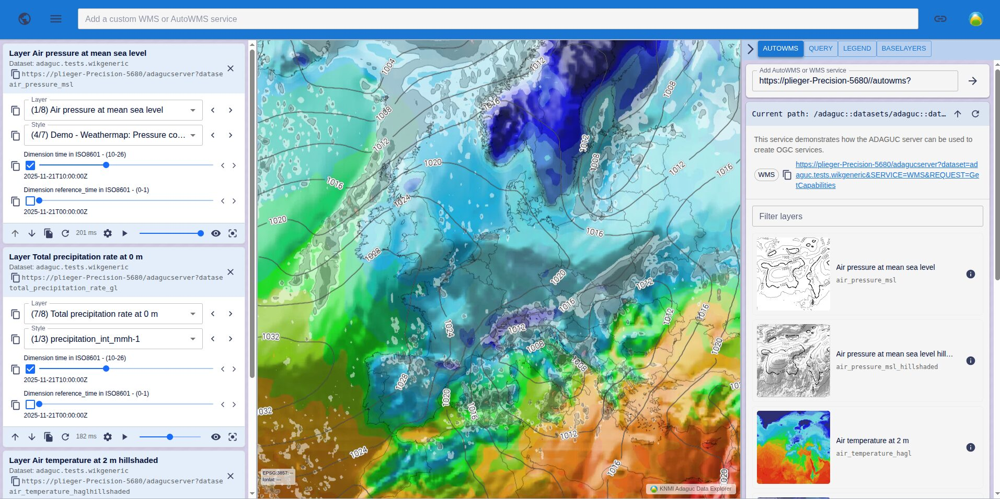

# Adaguc Data Explorer (ADE)

Browser-based viewer for WMS/WCS geospatial data, built for use with [Adaguc-Server](https://github.com/KNMI/adaguc-server) WMS services. For developers integrating or testing services, researchers visualizing datasets, and anyone building new WMS layers who needs a quick way to check rendering, styles, dimensions and legends.

This project is also used as the viewer in [Adaguc-Server](https://github.com/KNMI/adaguc-server)'s own Docker Compose setup, served at the `/explorer` path.



**Live demo:** https://knmi.github.io/adaguc-data-explorer/

Open a Adaguc AutoWMS service directly by passing it on the URL, e.g.
[`?autowms=https://geoservices.knmi.nl/autowms`](https://knmi.github.io/adaguc-data-explorer/?autowms=https://geoservices.knmi.nl/autowms).
A URL-encoded WMS `GetCapabilities` link works too:
[`?autowms=https%3A%2F%2Fgeoservices.knmi.nl%2Fadagucserver%3Fdataset%3D10-minute-in-situ-meteorological-observations%26SERVICE%3DWMS%26REQUEST%3DGetCapabilities`](https://knmi.github.io/adaguc-data-explorer/?autowms=https%3A%2F%2Fgeoservices.knmi.nl%2Fadagucserver%3Fdataset%3D10-minute-in-situ-meteorological-observations%26SERVICE%3DWMS%26REQUEST%3DGetCapabilities).

## Quick start

```bash
nvm use 22
npm ci
npm start   # http://localhost:4000
```

## Scripts

| Command                | Purpose                                             |
| ----------------------- | ---------------------------------------------------- |
| `npm start`             | Dev server with hot reload                            |
| `npm run build`         | Production build → `dist/` (serve with `npx serve dist`) |
| `npm test`              | Run the test suite                                    |
| `npm run lint`          | Prettier + ESLint                                     |
| `npm run storybook`     | Component storybook (uses `stories/`)                 |

## Built with

This project is built on top of the [OpenGeoWeb](https://www.npmjs.com/org/opengeoweb) packages, in particular [`@opengeoweb/webmap-react`](https://www.npmjs.com/package/@opengeoweb/webmap-react) (the React map components), along with [`@opengeoweb/webmap`](https://www.npmjs.com/package/@opengeoweb/webmap) and [`@opengeoweb/theme`](https://www.npmjs.com/package/@opengeoweb/theme).

## Docker

Prebuilt images are published to Docker Hub as [`knmiadaguc/adaguc-data-explorer`](https://hub.docker.com/r/knmiadaguc/adaguc-data-explorer):

```bash
docker run -it -p 8080:80 \
  -e ADAGUC_AUTOWMS_ENDPOINT=https://geoservices.knmi.nl/autowms \
  knmiadaguc/adaguc-data-explorer:main
# → http://localhost:8080
```

Or build locally:

```bash
docker build . -t adaguc-data-explorer
docker run -it -p 8080:80 \
  -e ADAGUC_AUTOWMS_ENDPOINT=https://geoservices.knmi.nl/autowms \
  adaguc-data-explorer
```
